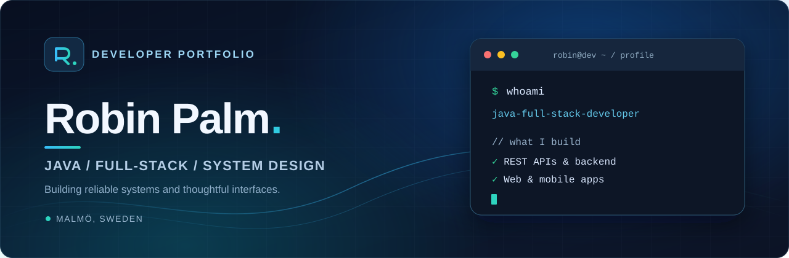

  

 

  <strong>Java developer in training · Backend & Full-stack development · Malmö, Sweden</strong>
    
  
  

---

### About me

I'm a **Java developer in training at EC Utbildning in Malmö**, building backend services, responsive websites and mobile applications.

My main focus is **Java, Spring Boot, REST APIs and SQL databases**, complemented by hands-on experience with **JavaScript, HTML, CSS, Bootstrap and React Native**. I enjoy working across the stack — from designing an API and data model to building the interface people use.

I'm interested in **software architecture, scalable services, clean code and thoughtful user experiences**.

### Tech stack

**Backend & databases**

  

**Frontend & mobile**

  

**Developer tools**

  

### Featured projects

| Project | Description | Technologies |
| :--- | :--- | :--- |
| **[BookingAPI](https://github.com/Pelmm/BookingAPI)** | Booking REST API designed to explore horizontal scaling, with multiple API instances behind an Nginx reverse proxy. | `Java` `Spring Boot` `PostgreSQL` `Docker` `Nginx` |
| **[Avspark](https://github.com/Pelmm/Avspark)** | Responsive football news website with article creation, categories, comments and reactions, using browser storage for demo content. | `HTML` `CSS` `JavaScript` `Bootstrap 5` |
| **[FilmApp](https://github.com/Pelmm/FilmApp)** | Mobile movie discovery app with search, accounts and user reviews. Integrates with the TMDB API through a custom backend. | `React Native` `Expo` `Node.js` `Express` `MongoDB` |
| **[FinanceDB](https://github.com/Pelmm/FinanceDB)** | Java-based personal finance application for managing transactions and generating financial reports with SQL persistence. | `Java` `JDBC` `PostgreSQL` `Gradle` |

### Currently focused on

- Designing and building robust **REST APIs** with Java and Spring Boot.
- Understanding **horizontal scaling, load balancing and database architecture**.
- Creating **responsive web interfaces** and connecting frontend applications to APIs.
- Improving code quality through **clear architecture, testing and maintainability**.

---

  Always learning. Always building.

